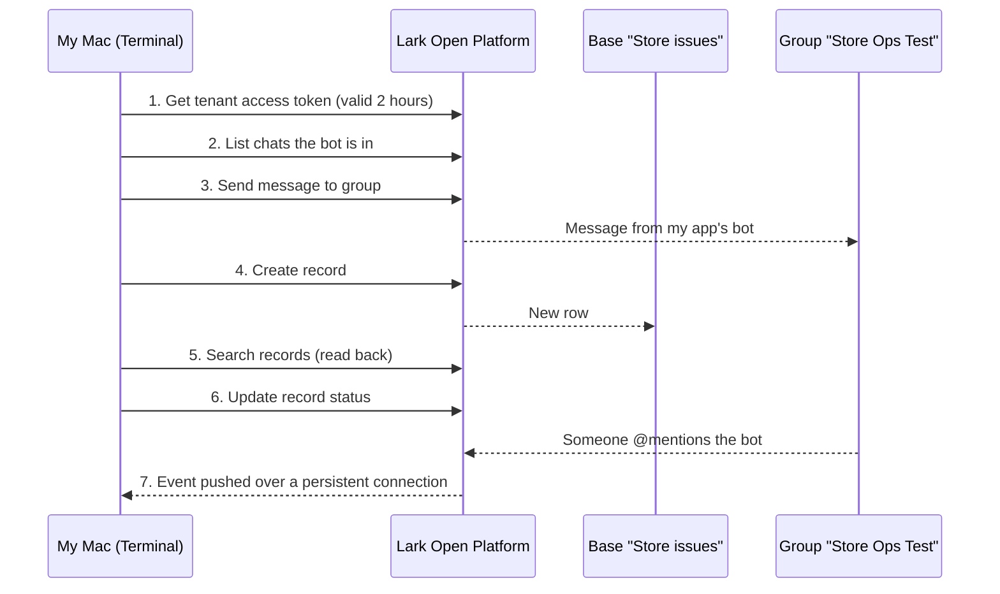

# Lark Open Platform Lab

A small hands-on lab to learn how Lark's Open Platform works end to end: authenticate, notify a group, create, read and update Base records, and receive events pushed by Lark.

**Scenario:** a store reports an issue, it is recorded in a Base, a group is notified, a manager approves, and the record is updated. It is an event-driven, human-in-the-loop business workflow, not a payments or settlement flow.

> Learning project, not production software. Every step marked done was run by me against my own Lark workspace. Built with help from Claude (an AI assistant); I ran, debugged and documented each step myself. See [`LOG.md`](LOG.md) for the step-by-step record.

## How the pieces fit

## What I ran

| # | Step | Call | Command | Result |
|---|---|---|---|---|
| 1 | Authenticate | `POST /auth/v3/tenant_access_token/internal` | `./lark_lab.sh check` | ✅ Token OK |
| 2 | Find the group | `GET /im/v1/chats` | `./lark_lab.sh chats` | ✅ After adding the bot to the group |
| 3 | Notify the group | `POST /im/v1/messages?receive_id_type=chat_id` | `./lark_lab.sh send "text"` | ✅ Message arrived from the app |
| 4 | Create a record | `POST /bitable/v1/apps/{app}/tables/{table}/records` | `./lark_lab.sh create "Store" "Issue"` | ✅ Row appeared in the Base |
| 5 | Read it back | `POST .../records/search` | `./lark_lab.sh search` | ✅ |
| 6 |
