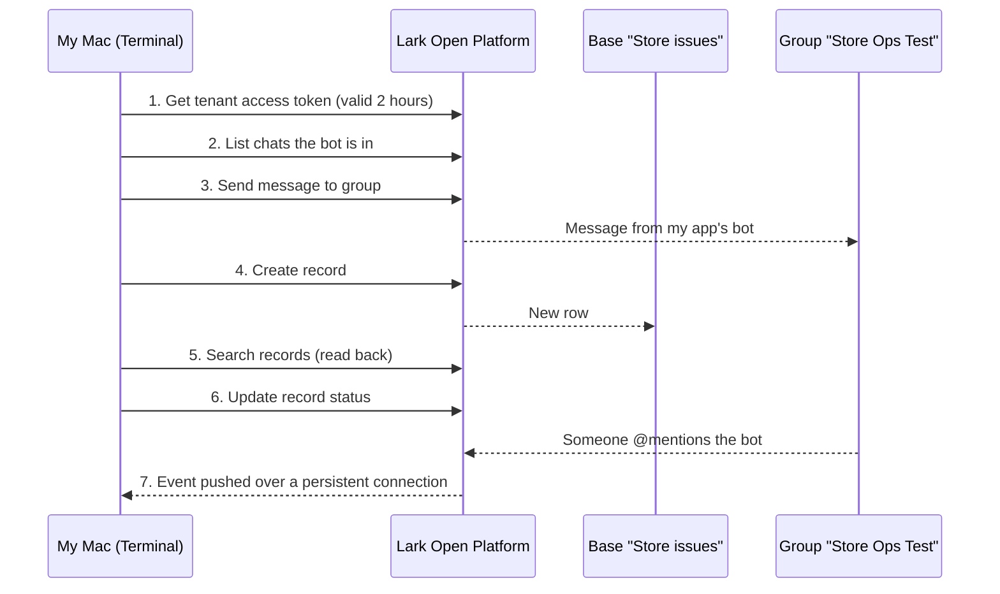

# Lark Open Platform Lab

A small hands-on lab to learn how Lark's Open Platform works end to end: authenticate, notify a group, create, read and update Base records, and receive events pushed by Lark.

**Scenario:** a store reports an issue, it is recorded in a Base, a group is notified, a manager approves, and the record is updated. It is an event-driven, human-in-the-loop business workflow, not a payments or settlement flow.

> Learning project, not production software. Every step marked done was run by me against my own Lark workspace. Built with help from Claude (an AI assistant); I ran, debugged and documented each step myself. See [`LOG.md`](LOG.md) for the step-by-step record.

## How the pieces fit

## What I ran

| # | Step | Call | Command | Result |
|---|---|---|---|---|
| 1 | Authenticate | `POST /auth/v3/tenant_access_token/internal` | `./lark_lab.sh check` | ✅ Token OK |
| 2 | Find the group | `GET /im/v1/chats` | `./lark_lab.sh chats` | ✅ After adding the bot to the group |
| 3 | Notify the group | `POST /im/v1/messages?receive_id_type=chat_id` | `./lark_lab.sh send "text"` | ✅ Message arrived from the app |
| 4 | Create a record | `POST /bitable/v1/apps/{app}/tables/{table}/records` | `./lark_lab.sh create "Store" "Issue"` | ✅ Row appeared in the Base |
| 5 | Read it back | `POST .../records/search` | `./lark_lab.sh search` | ✅ |
| 6 | Update the status | `PUT .../records/{record_id}` | `./lark_lab.sh update REC_ID "Approved"` | ✅ Status changed |
| 7 | Receive a push event | event subscription, persistent connection | `lark-cli event +subscribe --event-types im.message.receive_v1` | ✅ Event received |
| – | No-code Base workflow | Workflow: record added, then send message | built in the Lark Base UI | ⚠️ Built and activated, but the Activity Log showed no runs. Cause not found. |

## What I learned

1. **Everything starts with a token.** Each call needs a tenant access token that expires after 2 hours, so a script fetches a fresh one before it does anything else.
2. **A bot only sees what it has been added to.** My first `chats` call returned an empty list because the bot wasn't in the group. After adding scopes or events, I also had to publish a new app version before they took effect.
3. **The IDs matter.** I took the Base token and table ID from the Grid view URL. My first copy came from the Workflow page, so the table ID was wrong.
4. **Data comes back in a different shape from how it goes in.** I wrote text fields as plain strings, but reading them back returned rich-text lists.
5. **Blank records are a real edge case.** Clicking "+" in the Base created empty rows, which I could see in the data. A workflow should check required fields are filled before it acts.
6. **Push is different from pull.** The app, the subscribed event and the bot in the group all had to be the same app. My first listener was on a second app the CLI had created, so it heard nothing until I pointed it at the right one.
7. **Not everything worked first time.** I isolated each step on its own, and the same flow worked through the API even though the no-code workflow never showed a run.

## Gotchas I hit

- **Blank records.** Clicking "+" in the Base grid created empty rows, read back as `"fields": {}`.
- **Trailing spaces.** Two values typed in the grid came back with a space at the end (`"Chiller Fault "`); the API-created row had none.
- **"Is not empty" condition.** The workflow set to fire when Store and Issue are not empty showed no runs. I did not confirm the condition was the cause.
- **Bulk changes don't fire automations.** Lark's docs say pasting data, bulk updates and batch API calls do not trigger workflows. I used single-record calls.

## Common integration pitfalls, and where I hit them

General pitfalls I would expect with any chat-and-database integration (my own hypotheses, not Lark data). Items marked "hit" happened to me in this lab.

| Pitfall | In this lab |
|---|---|
| App version never published, so nothing changes | **Hit**: scopes and events had no effect until I published a new version |
| Bot not added to the group or Base | **Hit**: empty chat list until the bot was added |
| Wrong app or wrong IDs | **Hit**: listener on the wrong app; table ID from the wrong page |
| No public URL for event delivery | Avoided by using a persistent connection instead of a webhook |
| Rate limits during busy periods | Not tested. Messaging is documented as 5 per second per user or group |
| Duplicate events | Not tested. The plan is to de-duplicate by `event_id` |
| Silent failures nobody notices | **Seen** in the no-code workflow: no run, no error |

## Known gaps and next steps

- `lark_lab.sh` does not yet trim whitespace or reject empty values.
- No retries, idempotency keys (`uuid`) or event de-duplication yet.
- Find out why the no-code workflow never fired: remove the conditions and add them back one at a time.

## Run it yourself

1. Create a custom app at https://open.larksuite.com/app (international Lark, not Feishu) and add the Bot feature.
2. Enable scopes: `im:message`, `im:message:send_as_bot`, `im:chat`, and Base read/write. For events, add `im.message.receive_v1` and use a persistent connection.
3. Publish an app version, add the bot to a test group, and add the app to your Base.
4. `cp .env.example .env`, fill in the values, then `chmod +x lark_lab.sh`.

Requires `curl` and `python3`.

## Security

- Secrets live only in `.env`, which is git-ignored.
- Tokens, app secrets, chat IDs, message IDs and record IDs are redacted in `LOG.md`.
